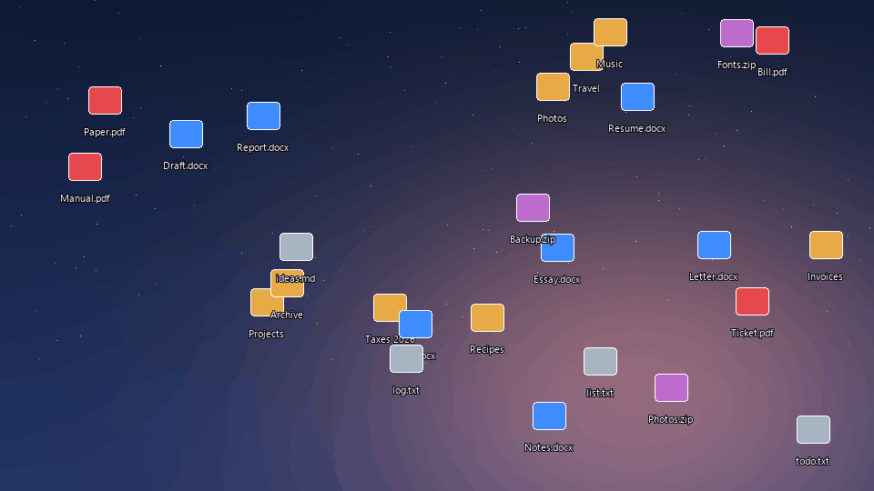

# Rivulet

**Tidy your Windows desktop. One small exe, 2-3 MB of RAM, no installer, and your files never move.**



*Illustration of the interaction, with made-up file names.*

Rivulet sorts your desktop icons by type into a slim rail of labels on the left. Click a label and that section flows open. Click it again, or click empty desktop, and it folds away.

## Why

- **Tiny.** A single exe of about 536 KB, written in Rust.
- **Light.** Measured at 2-3 MB of its own memory while idle (10-17 MB counting Windows libraries shared with other programs), and almost no CPU.
- **Safe for your files.** Nothing is moved, renamed or hidden on disk. Only icon positions change, so every path keeps working.
- **Leaves your wallpaper alone.** It draws in its own see-through layer behind the icons.

## Features

- Sections by file type: Folders, Word, Excel, PowerPoint, PDF, Notes, Code, Apps, Zips.
- **Recent** shows what you created or changed in the last 3 days, wherever it belongs.
- **A dot** on a label means something new arrived that you have not looked at.
- **Drag an icon onto a label** to file it there for good.
- **Ctrl+Alt+D** shows the desktop with your last section open. Press again to go back.
- **A Settings label** for themes, labels on the left or right, animation speed, and more.
- **Double-click empty desktop** to hide the labels for a completely clean screen, and again to bring them back.
- **Four styles.** Plain is the default and uses 2-3 MB. Smooth adds soft corners and shadows (60-90 MB). Glass is frosted glass made from your own wallpaper (55-100 MB). Liquid is nearly clear glass: the picture bends through the rim with a touch of colour fringing, light follows the curve, and panels wobble as they open (60-120 MB). The last three need the graphics card; with Plain, those libraries are never loaded.
- Colours per section, five themes, and tints that follow your wallpaper.
- New files are sorted as they arrive, and it recovers by itself if Explorer restarts.

## Install

1. Download `rivulet.exe` from [Releases](../../releases) and put it in its own folder, such as `Documents\Rivulet`. It keeps its settings beside itself.
2. Double-click it.

To start it with Windows, run `rivulet.exe --install-login` from a terminal in that folder. This uses a Task Scheduler logon task, because Windows can take minutes to work through the Startup folder on a busy PC, and icons would sit in columns until then. `rivulet.exe --install` adds a Start menu entry.

**Windows may warn you.** Rivulet is unsigned, so SmartScreen can say it is unrecognised, and antivirus tools may be wary because it watches mouse clicks on the desktop and moves icons inside Explorer. It has to do both to work: the click watcher is how labels respond, and it reads nothing else. It makes no network connections. The source is all here, so you can build it yourself:

```
cargo build --release
```

## Using it

| To do this | Do this |
|---|---|
| Open or close a section | Click its label |
| Close the open section | Click empty desktop |
| File an icon in a section | Drag it onto the label |
| Show the desktop and last section | Ctrl+Alt+D |
| Hide or show the labels | Double-click empty desktop |
| Change themes and behaviour | Click the Settings label |
| Re-sort, edit rules, undo or stop | Right-click any label |

## Your own rules

Right-click a label and choose **Edit rules** to open `sections.ini`. For example, to send anything with "thesis" in its name to Word:

```ini
[names]
*thesis* = Word
```

To make a section of your own, such as Thesis, add one line under each of these headings:

```ini
[types]
Thesis =

[names]
*thesis* = Thesis

[layout]
column5 = Thesis

[colours]
Thesis = 38C6D9
```

The same file also sets the shortcut and the screen. It explains each setting.

## Stopping and removing it

- **Undo and stop** in the right-click menu puts icons back where they were when Rivulet first started.
- To remove it: choose Undo and stop, run `rivulet.exe --remove-login` if you turned on starting at login, then delete its folder.
- **If icons ever seem to vanish,** right-click the desktop and choose Refresh. That always brings them back, even if Rivulet has crashed. It hides icons by placing them off-screen, and Windows pulls them back on Refresh.

## Status and limits

This is an early release, so please read this.

- **Tested on one setup:** Windows 11 version 26H2 (build 26300), one 1920x1080 screen at 125%. Tests covered a forced crash, an Explorer restart, Undo and repeated Refreshes.
- **Older Windows versions are untested.** There is a fallback for the older desktop layout, but it has never been run on a real machine. It needs Windows 10 version 1703 or later.
- **A second screen is untested.** Choosing a screen in the rules is written and unit tested, but has not been tried on real hardware.
- In the Plain style, rounded corners are slightly rough, because Windows does not allow fine per-pixel transparency in this layer without a much heavier drawing method.
- Glass and Liquid assume the wallpaper uses Windows' Fill setting. With another setting, or across a second screen, the picture in the glass may not line up with the real one.
- Hidden icons can flash for a moment on Refresh.
- It relies on undocumented Windows behaviour, so a Windows update could break it.
- One section opens at a time, and a section cannot hold more icons than fit on the screen.

If something breaks, run `rivulet.exe --doctor` and [open an issue](../../issues/new/choose) with the report. It contains no file names.

## How it compares

[Stardock Fences](https://www.stardock.com/products/fences/) is the established paid tool for this, and it has many more features and years of testing. Choose it if you want polish and support. Rivulet is for people who want something tiny and open source that does less. I have not measured Fences, so this README makes no claim about its memory use.

## Licence

MIT
